<div align="center">

  <!-- Engineering Velocity Wave (100% Transparent Telemetry) -->
  

  <h1>Nigish Fredolin</h1>

  <!-- Dynamic Typing Headline -->
  <a href="https://github.com/fredolin0109-hub">
    
  </a>

  <br/><br/>

  <!-- Professional Badges -->
  
  &nbsp;
  <a href="https://www.linkedin.com/in/nigish-fredolin-87185837a/" target="_blank">
    
  </a>
  &nbsp;
  <a href="mailto:fredlin0109@gmail.com">
    
  </a>
  &nbsp;
  <a href="https://github.com/fredolin0109-hub">
    
  </a>

</div>

<br/>

---

### 💡 About Me

```yaml
name: Nigish Fredolin
role: Aspiring Software Engineer & Problem Solver
core_stack: [C++, Python, Java, SQL]
interests: [Algorithms, Data Structures, Relational Database Design, System Architecture]
open_for: Software Engineering Internships & Collaborative Technical Projects
```

- 🧩 **Algorithmic Problem Solving:** Passionate about computer science fundamentals, algorithm efficiency, and clean code principles.
- ⚙️ **Core Engineering:** Developing software and backend services using **C++**, **Python**, and **Java**.
- 🗄️ **Data Persistence:** Architecting normalized schemas, indexed queries, and relational data operations in **SQL**.
- 🚀 Committed to building maintainable, scalable, and well-documented software solutions.

---

### 🛡️ Flagship Project: AegisTrace

> **AegisTrace** is a specialized tracing and system analysis engine engineered for observability, data verification, and robust operational tracking.

#### 🎥 Video Demonstration
<div align="center">
  <video src="assets/aegistrace-demo.mp4" controls width="100%" style="max-width: 780px; border-radius: 8px; border: 1px solid #1E293B;">
    Your browser does not support the video tag. Drop your video into assets/aegistrace-demo.mp4 to display here.
  </video>
</div>

<br/>

| Technical Highlights | Core Arsenal | Repository |
| :--- | :--- | :--- |
| **Systems Tracing & Data Observability** | `C++` · `Python` · `SQL` | [Source Repository](https://github.com/fredolin0109-hub) |

---

### 🛠️ Technical Arsenal

<div align="center">

  <h4>Core Programming Languages</h4>
  <a href="https://skillicons.dev">
    
  </a>

  <br/><br/>

  <h4>Databases & Relational Architecture</h4>
  <a href="https://skillicons.dev">
    
  </a>

  <br/><br/>

  <h4>Development Tools & Version Control</h4>
  <a href="https://skillicons.dev">
    
  </a>

</div>

<br/>

---

### 📊 Engineering Activity & Telemetry

<div align="center">
  <a href="https://github.com/fredolin0109-hub">
    
  </a>
  <a href="https://github.com/fredolin0109-hub">
    
  </a>
  <br/><br/>
  <a href="https://github.com/fredolin0109-hub">
    
  </a>
</div>

---

### 📂 Featured Technical Projects

| Project | Technologies | Focus & Architectural Scope | Source |
| :--- | :--- | :--- | :--- |
| **High-Performance Algorithm Suite** | `C++` · `STL` | Memory-optimized data structures and benchmarking suite | [Repository](#) |
| **Automated Data Processing Pipeline** | `Python` · `SQL` | Relational database ingestion, schema migrations, and indexing | [Repository](#) |
| **Object-Oriented Enterprise Core** | `Java` · `Design Patterns` | Modular, maintainable application built on clean OOP paradigms | [Repository](#) |

<br/>

---

<div align="center">
  <sub>Designed with precision by <a href="https://github.com/fredolin0109-hub">Nigish Fredolin</a></sub>
</div>
