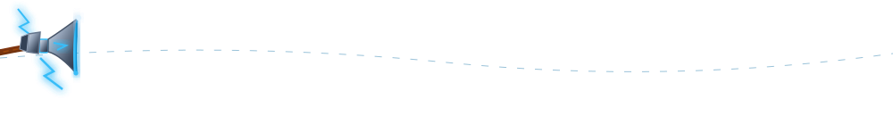

<div align="center">

  <!-- Asgardian Thunder Header Wave -->
  

  <br/>

  <!-- Stormbreaker Roaming Across the Page -->
  

  <br/><br/>

  <!-- Thor Summoning Lightning with Stormbreaker -->
  

  <br/><br/>

  <!-- Animated Lightning Speech Banner -->
  <a href="https://github.com/fredolin0109-hub">
    
  </a>

  <br/><br/>

  <!-- Thunder Badges in Electric Blue & Navy -->
  
  &nbsp;
  <a href="https://www.linkedin.com/in/nigish-fredolin-87185837a/" target="_blank">
    
  </a>
  &nbsp;
  <a href="mailto:fredlin0109@gmail.com">
    
  </a>
  &nbsp;
  <a href="https://github.com/fredolin0109-hub">
    
  </a>

</div>

<br/>

---

### 📜 Asgardian Codex (`About Me`)

```yaml
identity: Nigish Fredolin
title: God of Thunder • Aspiring Software Engineer
motto: "I choose to run towards my problems, and not away from them. Because that's what heroes do. ⚡"
core_arsenal: [C++, Python, Java, SQL]
mission: Forging high-performance algorithms & rock-solid relational architectures
weapon_of_choice: Stormbreaker & Clean Architecture 🔨
```

- ⚡ **Aspiring Software Engineer** wielding deep computer science fundamentals, efficient memory control, and resilient backend systems.
- 🔨 **Core Foundations:** Actively solving algorithmic challenges and architecting programs in **C++**, **Python**, and **Java**.
- 🗄️ **Database Architecture:** Designing structured schemas, optimized indexing, and robust queries using **SQL**.
- 🌌 Open to software engineering internships, collaborative technical projects, and open-source contributions.

---

### ⚡ Nidavellir Armory (`Core Arsenal`)

<div align="center">

  <h4>Core Programming Languages</h4>
  <a href="https://skillicons.dev">
    
  </a>

  <br/><br/>

  <h4>Databases & Query Architecture</h4>
  <a href="https://skillicons.dev">
    
  </a>

  <br/><br/>

  <h4>Development Environment & Version Control</h4>
  <a href="https://skillicons.dev">
    
  </a>

</div>

<br/>

---

### 🐍 Bifrost Energy Grid (`Contribution Matrix`)

<div align="center">
  <picture>
    <source media="(prefers-color-scheme: dark)" srcset="https://raw.githubusercontent.com/fredolin0109-hub/fredolin0109-hub/output/github-contribution-grid-snake-dark.svg">
    <source media="(prefers-color-scheme: light)" srcset="https://raw.githubusercontent.com/fredolin0109-hub/fredolin0109-hub/output/github-contribution-grid-snake.svg">
    
  </picture>
</div>

---

### 🌌 Realm Telemetry (`Engineering Activity`)

<div align="center">
  <a href="https://github.com/fredolin0109-hub">
    
  </a>
  <a href="https://github.com/fredolin0109-hub">
    
  </a>
  <br/><br/>
  <a href="https://github.com/fredolin0109-hub">
    
  </a>
</div>

---

### 🔨 Forged in Nidavellir (`Featured Projects`)

| Project | Tech Arsenal | Mission Brief | Repository |
| :--- | :--- | :--- | :--- |
| **Project 01** | `C++`, `Data Structures` | High-performance algorithm implementation with optimized memory management | [View Source](#) |
| **Project 02** | `Python`, `SQL` | Automated data pipeline & relational database querying system | [View Source](#) |
| **Project 03** | `Java`, `OOP` | Object-oriented application system with clean design patterns | [View Source](#) |

*(Update these with your real repository links as your projects deploy!)*

<br/>

---

<div align="center">
  <!-- Stormbreaker Roaming Flight Divider -->
  
  <br/>
  <h3>⚡ FOR ASGARD • CODING WORTHY ⚡</h3>
  <sub>Forged with Thunder by <a href="https://github.com/fredolin0109-hub">Nigish Fredolin</a></sub>
</div>
